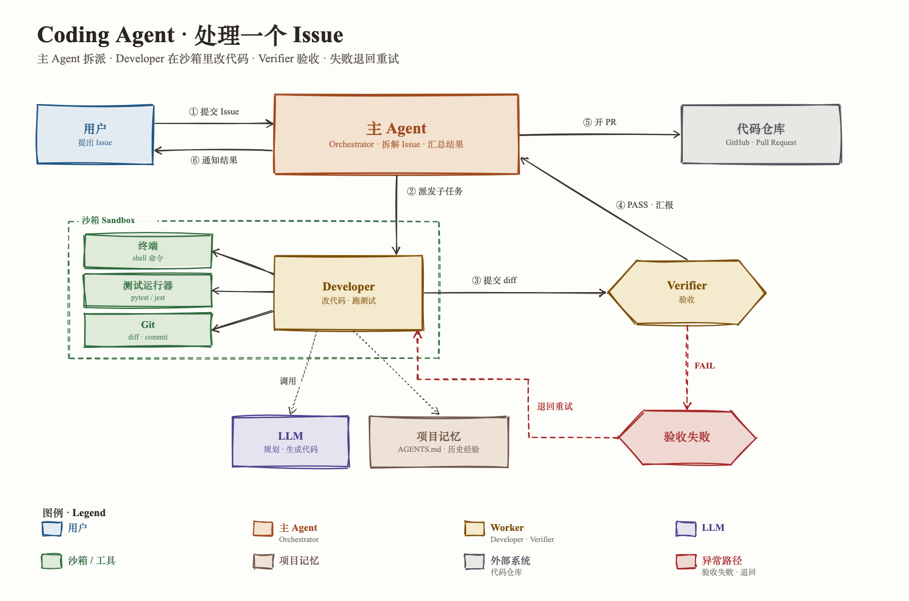

# handdrawn-diagram

An [Agent Skill](https://agentskills.io) for rendering hand-drawn, sketch-style architecture and flow diagrams with [rough.js](https://roughjs.com). It keeps a whole series of figures visually consistent: a fixed 9-color palette, serif print typography (Chinese 宋体 / 中宋 + Latin Times New Roman), no emoji, and one concept-to-color dictionary for Agent / Multi-Agent topics.



## What the agent gets

| Path | Purpose |
|---|---|
| `SKILL.md` | Hard rules, workflow, render and self-check steps |
| `templates/diagram.html` | Single-file template: palette, shape / arrow / label helpers, `node()` and `frame()`; edit only `main()` |
| `templates/diagram-binding.md` | Blank concept → color binding table, filled once per multi-diagram series so every figure uses the same colors |
| `templates/domain-dictionary.md` | Blank per-domain dictionary for mapping a new domain onto the 9 colors |
| `references/palette.md` | 9 colors with verified WCAG contrast, each slot's abstract meaning, color-cap rules |
| `references/typography.md` | Font stacks, punctuation, no-emoji policy |
| `references/shapes.md` | Shape semantics (box, channel, task card, bubble, hexagon, timeline, group frame) |
| `references/domains/` | Filled domain dictionaries: Agent Team, vertical search |
| `examples/` | Coding-agent diagram (8 colors + legend), Agent concept cheatsheet, and a 3-diagram vertical-search series with its binding file |

## Install

With the [`skills` CLI](https://github.com/vercel-labs/skills), which works with Claude Code, Codex, Cursor, OpenCode and others:

```bash
npx skills add TrentChou/handdrawn-diagram
```

Or copy it by hand into your agent's skills directory, e.g. for Claude Code:

```bash
git clone https://github.com/TrentChou/handdrawn-diagram ~/.claude/skills/handdrawn-diagram
```

## Requirements

- A Chromium-based browser (headless Chrome, or Playwright) to rasterize the HTML to PNG.
- Network access at render time: rough.js 4.6.6 from jsDelivr (pinned with Subresource Integrity) and Noto Serif SC from Google Fonts as the CJK fallback.
- Best results with Times New Roman and a Songti font installed locally. macOS and Windows ship both; on Linux, labels fall back to Liberation Serif / Noto Serif SC.

## Usage

Ask your agent for a diagram, e.g. “画一张 Multi-Agent 架构图，手绘风格” or “draw a hand-drawn flowchart of our ingestion pipeline”. The skill has the agent copy the template, draw only the entities named in your brief, render a PNG with headless Chrome, and check it against the style rules before returning it.

To render a figure manually:

```bash
"/Applications/Google Chrome.app/Contents/MacOS/Google Chrome" --headless=new --disable-gpu \
  --hide-scrollbars --window-size=1720,1240 --virtual-time-budget=8000 \
  --screenshot="$PWD/out.png" "file://$PWD/templates/diagram.html"
```

## License

[MIT](LICENSE). Third-party assets are loaded from CDNs at render time, not bundled: rough.js (MIT) and Noto Serif SC (SIL Open Font License 1.1).
